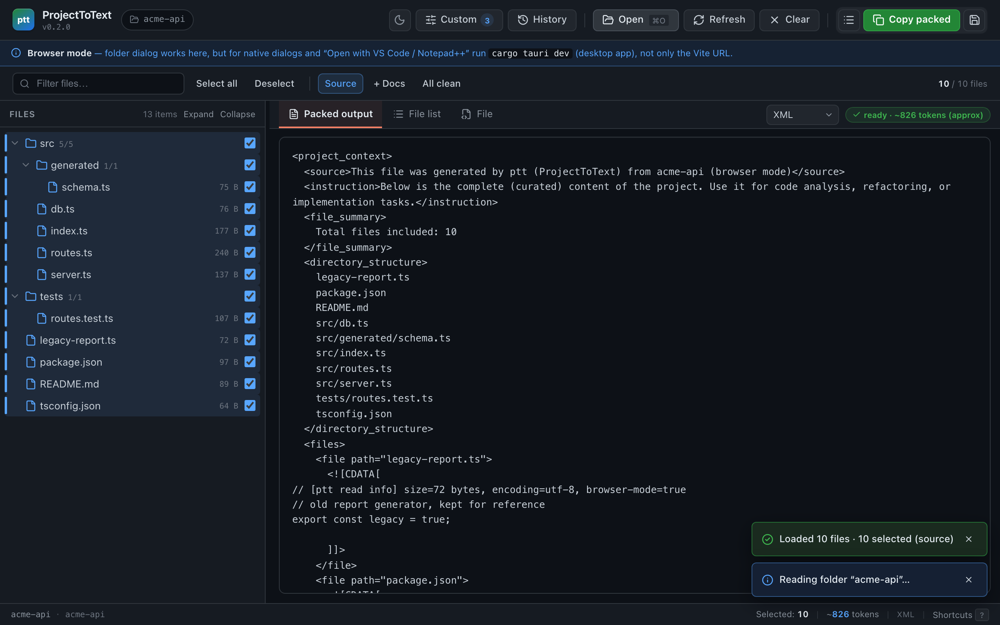
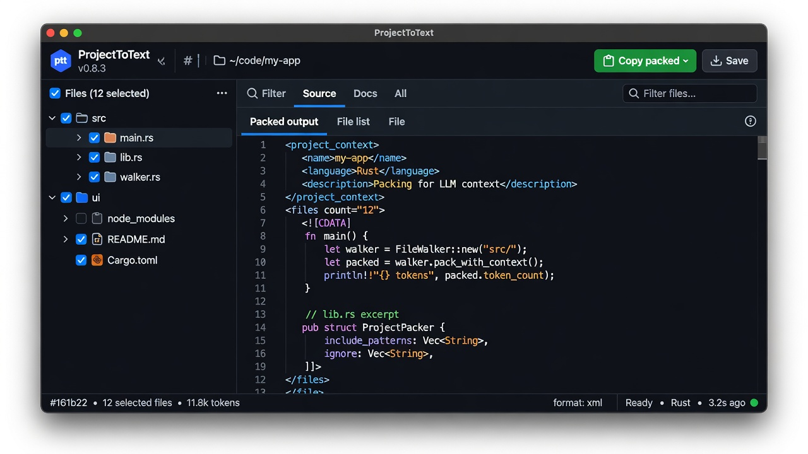
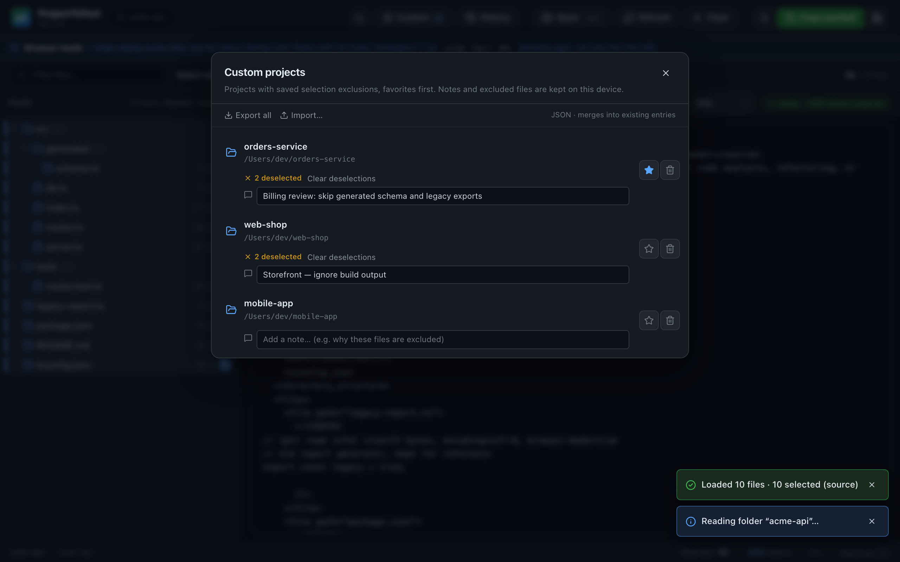
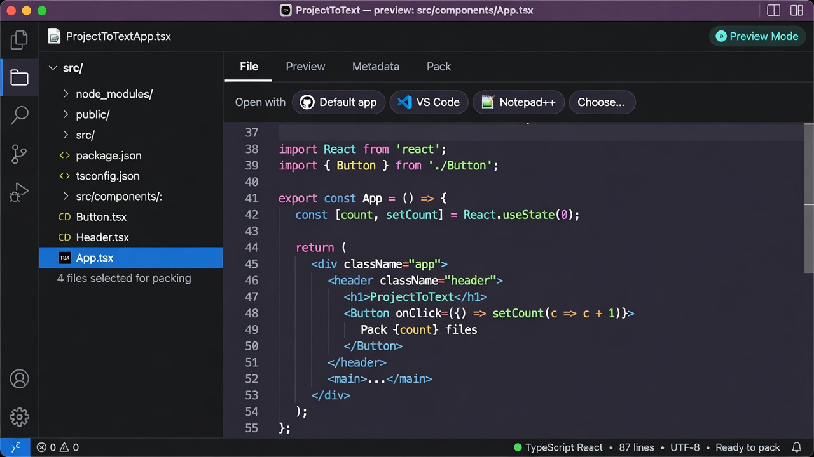

<div align="center">


# ProjectToText

**Your codebase. The context you choose.**

A desktop app and CLI that turn project files into structured context for AI assistants.
<br />
Inspect the tree, choose what matters, and export XML, Markdown, JSON, or plain text.

[](https://github.com/krzysztofautomatyk/ProjectToText/actions/workflows/ci.yml)
[](https://github.com/krzysztofautomatyk/ProjectToText/releases/latest)
[](#installation)
[](LICENSE)

**[Download](https://github.com/krzysztofautomatyk/ProjectToText/releases/latest)** · **[Quick start](#quick-start)** · **[CLI reference](#cli-reference)** · **[Report a bug](https://github.com/krzysztofautomatyk/ProjectToText/issues/new)**

</div>

<p align="center">
  
</p>

<p align="center"><sub>Open a folder → choose your files → review the output → copy or save.</sub></p>

ProjectToText (`ptt`) gives you control over what an AI assistant sees. Use the native desktop app to curate context visually, or the headless CLI to generate packs from scripts. **Packing happens locally:** no AI account, API key, or hosted processing service is required.

Use the exported text with ChatGPT, Claude, Gemini, Cursor, Copilot, or any tool that accepts text context. There are no built-in integrations with those services; you decide where the output goes.

## Contents

- [Why ProjectToText](#why-projecttotext)
- [Installation](#installation)
- [Quick start](#quick-start)
- [Features](#features)
- [CLI reference](#cli-reference)
- [MCP server](#mcp-server)
- [Output formats](#output-formats)
- [Ignore rules and selection](#ignore-rules-and-selection)
- [Privacy and safety](#privacy-and-safety)
- [Development](#development)
- [Architecture](#architecture)
- [FAQ](#faq)
- [Contributing and support](#contributing-and-support)
- [License and credits](#license-and-credits)

## Why ProjectToText

Copying files one by one loses structure. Exporting an entire repository adds noise. ProjectToText sits between the two: **a visual, selection-first workflow backed by a reusable Rust packing engine.**

| When you need to… | ProjectToText helps you… |
| :--- | :--- |
| Explain a bug across several files | Select the relevant implementation, configuration, and tests in one tree. |
| Ask for a focused refactor or code review | Inspect file previews before including them in the context. |
| Prepare a project handoff | Export file paths and contents together in a readable, structured pack. |
| Work repeatedly on the same repository | Reuse remembered exclusions, favorites, and project notes. |
| Generate context from a script | Run `ptt pack` without opening a desktop window. |

## Installation

**[Download the latest release →](https://github.com/krzysztofautomatyk/ProjectToText/releases/latest)**

Choose an installer from the release's **Assets** section. Replace `<version>` below with the release version.

| Your system | Download | Install |
| :--- | :--- | :--- |
| **macOS · Apple Silicon** — M1, M2, M3, M4, and newer | `ptt-<version>-macos-apple-silicon.dmg` | Open the DMG and drag **ptt.app** into **Applications**. |
| **macOS · Intel** | `ptt-<version>-macos-intel.dmg` | Open the DMG and drag **ptt.app** into **Applications**. |
| **Windows · x64** | `ptt-<version>-windows-x64-setup.exe` or `ptt-<version>-windows-x64.msi` | Run the installer, then launch **ptt** from the Start menu. |
| **Linux · x64** | `ptt-<version>-linux-x64.AppImage`, `.deb`, or `.rpm` | Make the AppImage executable, or install the package appropriate for your distribution. |

Files ending in `.sig`, `.app.tar.gz`, and `latest.json` are used by the updater, not the normal first-time installation flow.

### macOS: first launch

> [!IMPORTANT]
> **The macOS app is not notarized by Apple.** Releases from v0.2.6 use an ad-hoc bundle signature, not a Developer ID certificate. Gatekeeper can still show **“Apple cannot verify ptt.app”**. This is a known distribution limitation, not a problem specific to M4 Macs.

If you downloaded the app from this repository's official release and trust it:

1. Copy **ptt.app** to **Applications**, then try to open it.
2. In the warning, click **Done**, not **Move to Bin**.
3. Open **System Settings → Privacy & Security**.
4. Scroll to the security section and click **Open Anyway** for `ptt.app`.
5. Confirm **Open** and authenticate if macOS asks. The approval normally only needs to be done once for that app.

The **Open Anyway** option is available for about an hour after the blocked launch. On a managed Mac, your organization's policy may prevent this override.

<details>
<summary>Terminal alternative — only for a download you trust</summary>

After copying the app into Applications:

```bash
xattr -dr com.apple.quarantine /Applications/ptt.app
```

This removes the downloaded app's quarantine attribute and bypasses the associated first-launch Gatekeeper check. It does **not** notarize the app, prove that it is safe, or repair a corrupted download. Do not disable Gatekeeper system-wide.

</details>

### Windows and Linux notes

- **Windows:** releases are not Authenticode-signed, so SmartScreen may show an unrecognized-app warning. Verify the download source before deciding to continue. The Windows installer includes a WebView2 bootstrapper; fetching a missing runtime may need internet access.
- **Linux:** WebKitGTK and other runtime requirements depend on your distribution and package format. For missing-library errors or source builds, consult the [Tauri prerequisites](https://v2.tauri.app/start/prerequisites/).

## Quick start

### Desktop: curate context in five steps

1. **Open a project** using **Open folder**, drag-and-drop, or `⌘O` / `Ctrl+O`.
2. **Choose a preset:** **Source**, **Source + docs**, or **All clean**.
3. **Refine the selection:** filter the tree, toggle files or folders, and click a file to inspect its syntax-highlighted preview.
4. **Choose an output format:** start with **XML**, then review the generated context and approximate token count.
5. **Copy packed** into your assistant, or **Save** the pack for later.

For a more focused answer, include the files involved in your question rather than the whole repository. Add a clear task alongside the context, for example:

> Review the authentication flow in the attached project context. Identify correctness risks and suggest the smallest changes. Reference file paths in your answer.

### CLI: create a pack in one command

Once the `ptt` executable is on your `PATH`:

```bash
ptt pack ./my-project -o ../context.xml
```

You can also launch the desktop app directly on a folder with `ptt ./my-project`. Unknown commands and invalid folder arguments report an error instead of opening an empty window.

Without `--preset`, `--include`, or `--exclude`, the CLI packs **all files returned by the ignore-aware scanner**. Saved desktop selections never apply to the CLI. Use `.pttignore`, a narrower directory, or the selection flags to control scope.

> Keep generated packs **outside the scanned project**, or explicitly ignore them. Otherwise a later run can include a previous export in its input.

Installing a desktop app does not necessarily add `ptt` to your `PATH`. See [development](#development) to build the executable locally.

## Features

### Select deliberately

- **Interactive file tree** with partial folder selection and filtering.
- **Selection presets** for source, source plus documentation, and all files excluding common junk paths.
- **Syntax-highlighted previews** to inspect a file before packing it.
- **Native editor actions** to open files in supported editors such as VS Code or choose an application.
- **XML, Markdown, JSON, and plain text** output; copy packed contents, copy a file list, or save to disk.

### Keep your workflow

- **Folder history** with pinned projects and quick reopen.
- **Custom projects** with favorites, notes, and remembered file/folder exclusions.
- **Preferences export/import** as a JSON snapshot for moving settings between machines. These snapshots can contain local project paths and notes; review them before sharing.
- **Light, dark, and system themes**, a resizable workspace, and keyboard shortcuts.
- **Desktop update checks:** release builds check GitHub for updates on startup; installation is user-triggered and updater signatures are verified.

### Pack with guardrails

- **Git-aware scanning** in desktop and CLI: prefer Git itself inside a work tree, with the Rust `ignore` crate as a fallback.
- **Additional exclusions** through root and nested `.pttignore` files, including directory rules and scoped negations.
- **A revisioned workspace index** reused for selection changes. Use **Refresh** for new/removed files; changes to indexed ignore files block generation until refresh.
- **UTF-8 and BOM-declared UTF-16LE/BE** in pack and preview. Unsupported or malformed encodings are reported rather than silently replaced.
- **A default 2 MiB per-file limit**, binary detection, and skipped symlinks in the Rust packing path.
- **Relative file paths** in output; the Rust packer records the project folder name rather than its absolute location.
- **Exact BPE token counts** per file and per pack, using `tiktoken` (`o200k_base` by default, `cl100k_base` available). The Claude and Gemini profiles scale the `o200k_base` count by a fixed factor, so they are approximations. Counts are for planning, not billing.
- **Bounded output preview** for large packs: above 150,000 characters, initially display 100,000. Copy and Save still use the complete output; full preview is opt-in.

### Context budget, skeletons, and Git

- **Context budget:** choose a target window (32k, 64k, 128k, 200k, 1M, or a custom size). A progress bar shows packed tokens against it. **Top Token Consumers** lists the heaviest selected files with one-click Skeleton or Exclude actions. **Auto-Fit** deselects low-priority files (tests, fixtures, lockfiles, docs) until the selection is at most 90% of the budget. The CLI equivalent is `--max-tokens`.
- **AST skeletons:** a tree-sitter pass keeps signatures, types, imports, and doc comments while removing function bodies. It covers Rust, TypeScript/TSX, JavaScript, Python, Go, C#, Java, C, and C++; other files use a brace or indentation fallback. Mark a file or folder with `[S]`. On this repository's own source, skeleton mode cut the exact token count by about 75% (see [engineering review](docs/EXPERT_REVIEW.md)).
- **Dependency neighbors (desktop app):** from a file's context menu, select its imports, its importers, or its related tests.
- **Git context:** tree badges mark modified, added, untracked, and deleted files. **Select Git Modified** and **Select Branch Changes** select them in one step, and **Include `<git_diff>`** adds the unified diff to the pack.
- **Prompt templates:** a collapsible prompt bar offers tasks such as architecture and code review, bug investigation, security audit, and test writing. The task is appended as `<task_instructions>` at the end of the pack, after the files.

<details>
<summary>Keyboard shortcuts</summary>

Use `⌘` on macOS and `Ctrl` on Windows/Linux.

| Action | Shortcut |
| :--- | :--- |
| Open folder | `⌘/Ctrl + O` |
| Refresh project | `⌘/Ctrl + R` |
| Focus file filter | `⌘/Ctrl + F` |
| Copy packed output or file list, depending on the active view | `⌘/Ctrl + C` outside an input field |
| Save output | `⌘/Ctrl + S` |
| Show shortcut help | `?` outside an input field |
| Dismiss dialogs or clear the filter | `Esc` |

</details>

<details>
<summary>Interface gallery</summary>

| File preview | Custom projects | Light theme |
| :---: | :---: | :---: |
|  |  |  |

Images include earlier-version captures and illustrative interface views; current labels and layout may differ. See the [screenshot assets](docs/screenshots/).

</details>

## CLI reference

```text
ptt pack [DIR] [OPTIONS]
```

| Argument / option | Description | Default |
| :--- | :--- | :--- |
| `[DIR]` | Project directory to scan | Current directory |
| `-f, --format <FMT>` | `xml`, `markdown`, `json`, or `plain` | `xml` |
| `-o, --output <FILE>` | Write to a file instead of standard output | Standard output |
| `--no-summary` | Omit the XML file summary; other formats are unchanged | Include summary |
| `--max-size <N>` | Maximum file size in bytes; larger files are represented by notes | `2097152` (2 MiB) |
| `--preset <PRESET>` | `source`, `docs`, or `all` (lockfiles and `gen/schemas/` are never selected by presets) | none |
| `--include <GLOB>` / `--exclude <GLOB>` | Keep only matching files / drop matching files; repeatable | none |
| `--skeleton [GLOB]` | Pack all files, or files matching `GLOB`, as AST skeletons | off |
| `--git-modified` | Select only modified, staged, and untracked files | off |
| `--git-branch` | Select only files changed on the current branch versus its base | off |
| `--git-diff` | Include a unified `<git_diff>` block | off |
| `--max-tokens <N>` | Auto-fit the selection to 90% of `N` tokens | none |
| `--prompt <TEXT>` | Append `<task_instructions>` at the end of the pack | none |
| `-c, --copy` | Copy the pack to the system clipboard instead of printing it | off |
| `--no-redact` | Disable secret masking (not recommended) | redaction on |
| `-h, --help` | Show packing usage | — |

```bash
# XML for structured context
ptt pack ./my-project -o ../context.xml

# Markdown for a readable handoff
ptt pack ./my-project -f markdown -o ../context.md

# JSON for scripts and downstream tools
ptt pack ./my-project --format json > ../context.json

# Plain text with a 1 MiB per-file limit
ptt pack ./my-project -f plain --max-size 1048576 -o ../context.txt

# XML without the optional file summary
ptt pack ./my-project --no-summary -o ../context-compact.xml

# Source files only, skeletonized, fitted to a 128k-token window, copied to the clipboard
ptt pack . --preset source --skeleton --max-tokens 128000 -c

# Only what changed on this branch, with the diff and a task prompt
ptt pack . --git-branch --git-diff --prompt "Review these changes for regressions."

ptt pack --help
ptt --version
```

## MCP server

`ptt mcp [DIR]` runs a Model Context Protocol server (JSON-RPC 2.0 over stdio) so AI assistants can request context on demand. It exposes three tools:

| Tool | Returns |
| :--- | :--- |
| `ptt_get_project_map` | Directory tree, exact token counts per file, and skeletons of key modules. |
| `ptt_pack_files` | A pack of the requested files, respecting `.gitignore`, `.pttignore`, and secret masking. |
| `ptt_get_git_context` | Modified files and the current `git diff`. |

Example client configuration (Claude Desktop and Cursor accept a similar entry):

```json
{
  "mcpServers": {
    "ptt": {
      "command": "ptt",
      "args": ["mcp", "/absolute/path/to/your/project"]
    }
  }
}
```

The server communicates only over stdio. A tool call may name a different directory than the startup `DIR`, and reads go through the same ignore and redaction rules as `ptt pack`. Connect only clients you trust.

Packed data goes to standard output unless `-o` is set; status messages go to standard error. Exit codes are **0** on success, **1** for a packing/output failure, and **2** for invalid arguments.

**A successful exit is not a guarantee that every file's contents were included.** Binary, oversized, or unreadable files can appear as explanatory notes. Review the pack before using it.

## Output formats

In XML, `<directory_structure>` is alphabetical, but `<file>` contents are emitted by architectural tier: source and entrypoints first, then manifests and build configs, then tests and examples, then documentation and CI metadata. If an LLM truncates a long pack, it drops docs before code. `<git_diff>` and `<task_instructions>` come after the files.

| Format | Use it for | Structure |
| :--- | :--- | :--- |
| **XML** | Explicit file boundaries in structured prompts | Project metadata, directory listing, and `<file path="…">` entries with CDATA contents. |
| **Markdown** | Human-readable handoffs and chat context | File headings followed by fenced contents. |
| **JSON** | Automation and downstream processing | Metadata plus a `files` array with `path`, `size`, and `content`. |
| **Plain text** | Simple text-based workflows | File paths and contents separated by markers. |

A shortened XML pack looks like this; metadata and the summary are omitted here for readability:

```xml
<project_context>
  <directory_structure>
    src/main.rs
    README.md
  </directory_structure>
  <files>
    <file path="src/main.rs">
      <![CDATA[
fn main() {
    println!("Hello, context!");
}
      ]]>
    </file>
    <file path="README.md">
      <![CDATA[
# My project
      ]]>
    </file>
  </files>
</project_context>
```

## Ignore rules and selection

### Desktop and CLI

Inside a Git work tree, the scanner uses `git ls-files --cached --others --exclude-standard`: **tracked files plus untracked files that Git does not ignore**. If Git is unavailable or the folder is not a work tree, the Rust `ignore` crate supplies the fallback scan.

> [!NOTE]
> Adding an already-tracked file to `.gitignore` does not make Git stop tracking it. Such files can still appear in a pack. Add an explicit `.pttignore` exclusion and review the output when handling sensitive files.

Create a `.pttignore` in the project root for exclusions that should apply to context packs without changing the repository's normal ignore policy:

```gitignore
# Credentials and private data
.env
.env.*
secrets/**

# Generated files and large fixtures
*.log
*.min.js
**/generated/**
fixtures/large/**

# Previous context exports, if stored in the project
context.xml
context.md
context.json
context.txt
```

`.pttignore` uses Gitignore-style patterns. Nested files apply within their own directories; an ignored parent directory must be re-included before one of its children can be re-included. Desktop presets narrow the scanned files further; remembered exclusions are replayed when you reopen a project. Re-checking a file clears its saved exclusion.

Presets never check lockfiles (`package-lock.json`, `pnpm-lock.yaml`, `yarn.lock`, `Cargo.lock`, `composer.lock`, `Gemfile.lock`, `poetry.lock`, `uv.lock`) or `gen/schemas/`. They stay visible in the tree, so you can select them by hand when you need them.

### Browser mode is different

The browser fallback uses browser file APIs and common junk-directory filters. It does **not** run Git or implement the Rust scanner's `.gitignore` / `.pttignore` behavior. Use desktop or CLI when ignore fidelity matters.

## Privacy and safety

**Your project contents are processed on your machine, not uploaded to a packing service.** Copying or saving the output is your choice; sending it to an AI provider is a separate action under that provider's policies.

| Guardrail | What it means |
| :--- | :--- |
| Local packing | Reading files and generating context do not require an AI service or API key. |
| Update checks | Desktop release builds contact GitHub for update metadata and, when requested, artifacts. Local packing does not mean the entire app is network-free. |
| File handling | The Rust packer checks path components and canonical root containment, rejects links/reparse points, and replaces binary or oversized contents with notes. These checks are not a race-proof sandbox against concurrent filesystem mutation. |
| Secret masking | Packed output (desktop, CLI and browser mode, all formats) replaces recognizable credentials with `[REDACTED: <KIND>]`: provider tokens (AWS, Anthropic, OpenAI, Google, Stripe, GitHub, Slack), PEM private key blocks, URL basic-auth passwords, `Password=` / `*_PASSWORD=` values, and `*_SECRET`, `*_TOKEN`, `*_API_KEY`, and `*_PRIVATE_KEY` assignments in `.env` style. Documentation placeholders such as `Password=...` are left alone. This is **best-effort**: secrets without a recognizable shape are not detected, and ignore rules and presets do not redact anything. Use `--no-redact` only for packs you will never share. Review the pack before sharing. |
| Context limits | Token counts are exact for `o200k_base` and `cl100k_base`, and approximate for the Claude and Gemini profiles. The context budget (`--max-tokens` or the desktop budget bar) plans a selection against a window size, but the 2 MiB file limit is per file, not per pack. |

Review both the selection and the generated pack before sharing. Treat source files as untrusted context, not instructions for an assistant to execute.

For vulnerability reporting, see the [security policy](SECURITY.md). OS signing/notarization and updater signatures are separate: a verified updater signature does not remove Gatekeeper or SmartScreen warnings.

## Development

### Prerequisites

| Requirement | Notes |
| :--- | :--- |
| **Rust + Cargo** | Use a current stable toolchain from [rustup](https://rustup.rs/). The package declares Rust 1.90 as its minimum, the highest minimum among its resolved dependencies. CI builds with the current `stable` toolchain, so 1.90 itself is not exercised in CI. |
| **Node.js + npm** | Node **22.12+** or a newer supported LTS; Node 24 is a suitable choice for the current toolchain. |
| **Git** | Required to clone; also enables the native Git scanning path. |
| **Tauri system dependencies** | Follow the [platform prerequisites](https://v2.tauri.app/start/prerequisites/) for macOS, Windows, or Linux. |

On Windows, Rust is **not** included with the OS. Install Rust, restart your terminal, and install the MSVC C++ build tools and WebView2 prerequisites. See the [Windows setup guide](CONTRIBUTING.md#prerequisites-install-these-first).

### Run the desktop app

```bash
git clone https://github.com/krzysztofautomatyk/ProjectToText.git
cd ProjectToText
npm --prefix ui ci
cargo install tauri-cli --version "^2" --locked
cargo tauri dev
```

Run these commands from the repository root. Tauri starts the frontend development server and opens the native window.

### Run the browser UI

```bash
npm --prefix ui run dev
```

Open the local URL printed by Vite. This is a development fallback, not a hosted demo.

| Capability | Desktop | CLI | Browser fallback |
| :--- | :---: | :---: | :---: |
| Git-aware scan and `.pttignore` | Yes | Yes | No |
| Visual selection and previews | Yes | No | Yes |
| XML / Markdown / JSON / plain output | Yes | Yes | Yes |
| Native editor actions | Yes | No | No |
| Pack without a window | No | Yes | No |

### Build locally

```bash
# Desktop bundle; the frontend build is run by Tauri
cargo tauri build --ci --no-sign

# Executable only, without generating an installer
cargo build --release --locked
./target/release/ptt pack . -o ../context.xml
```

On Windows, the executable is `target\release\ptt.exe`. The executable-only build still uses the Tauri crate and requires the platform's build dependencies; it is not a separate minimal CLI package.

Bundles are written under `target/release/bundle/`, or `target/<target>/release/bundle/` for an explicit target. See the [installer guide](installer/README.md) for the platform-specific helper scripts.

The local bundle command skips OS code signing. Updater signing is separate: with `createUpdaterArtifacts` enabled, a full bundle build also needs the configured updater signing key. Do not commit signing credentials.

### Checks

After installing the prerequisites and frontend dependencies:

```bash
cargo fmt --all -- --check
cargo test --all-targets --locked
cargo clippy --all-targets --locked -- -D warnings
npm --prefix ui run lint
npm --prefix ui run typecheck
npm --prefix ui run build

# Install the browser once, then run the smoke tests against the build
cd ui
npx playwright install chromium
npm run test:e2e
```

On Linux, Playwright may also require OS dependencies; see the [CI workflow](.github/workflows/ci.yml) for `--with-deps` usage. If Make is available, `make check` runs the project's combined test/lint/build/browser-smoke pipeline.

CI runs Rust formatting, tests, and Clippy on macOS, Linux, and Windows; frontend lint/build and browser smoke tests run on Linux. Version tags trigger the [release workflow](.github/workflows/release.yml).

## Architecture

```text
ProjectToText/
├── src/
│   ├── main.rs             # Desktop commands and app bootstrap
│   ├── cli.rs              # Headless `ptt pack` entry point
│   ├── lib.rs              # Reusable Rust core library
│   └── core/
│   ├── mcp.rs              # Model Context Protocol server (`ptt mcp`)
│   └── core/
│       ├── walker.rs       # Git / ignore-aware file discovery and default exclusions
│       ├── output.rs       # XML, Markdown, JSON, and plain writers, architectural ordering
│       ├── secrets.rs      # Best-effort secret masking with per-kind counts
│       ├── tokenizer.rs    # Exact BPE counts (tiktoken) and model profiles
│       ├── skeleton.rs     # tree-sitter AST skeletons
│       ├── deps.rs         # Import / importer / test graph
│       ├── git.rs          # Status, branch changes, and diff
│       ├── workspace.rs    # Revisioned scan cache
│       ├── text.rs         # UTF-8 / UTF-16 decoding and safe fences
│       └── preview.rs      # Root-constrained file previews
├── ui/
│   ├── src/                # React + TypeScript interface and browser fallback
│   └── e2e/                # Playwright browser smoke tests
├── capabilities/           # Tauri permissions
├── installer/              # Platform-specific bundle helpers
├── docs/                   # Architecture notes and interface assets
└── .github/workflows/      # CI and release automation
```

The desktop and CLI share the Rust walker and output engine. Browser mode has a separate TypeScript implementation. Core modules are unit-tested without opening the GUI; browser smoke tests do not verify native installation or OS trust dialogs.

Read the [architecture guide](docs/ARCHITECTURE.md) for data flow and extension points. The [engineering review](docs/EXPERT_REVIEW.md) records reproduced bugs, measured selection performance, and remaining limitations without unsupported quality scores.

## FAQ

<details>
<summary><strong>Does ProjectToText call an AI model?</strong></summary>

No. It prepares context files. You choose the assistant or tool and send the output yourself. No AI API key is needed to pack a project.

</details>

<details>
<summary><strong>Does it work outside a Git repository?</strong></summary>

Yes. Desktop and CLI fall back to the Rust `ignore` crate. The browser UI uses browser file APIs instead and does not offer equivalent ignore behavior.

</details>

<details>
<summary><strong>Why is a file missing, or represented by a note?</strong></summary>

Check `.gitignore`, `.pttignore`, the active preset, and remembered exclusions. In the Rust packer, symlinks are skipped; binary, oversized, and unreadable files can be represented by notes rather than their contents. The default size limit is 2 MiB per file.

</details>

<details>
<summary><strong>Can I pack a monorepo?</strong></summary>

You can open a repository or a smaller subfolder, but there is no guaranteed repository-size or model-context budget. Start with the relevant package and narrow the selection. Browser directory-handle scanning has a 25,000-file guard; desktop and CLI use a different scanning path.

</details>

<details>
<summary><strong>Why do macOS or Windows show a security warning?</strong></summary>

Current releases do not have Apple notarization or Windows Authenticode signing. Follow the [installation notes](#installation) only after verifying the source and deciding to trust the download. Updater signatures protect a different step and do not establish OS publisher trust.

</details>

## Contributing and support

Focused improvements are welcome: reproducible bug reports, tests, accessibility fixes, documentation, and workflow refinements.

- **Found a bug?** [Open an issue](https://github.com/krzysztofautomatyk/ProjectToText/issues/new) with your OS, app version, reproduction steps, and expected behavior. Redact private paths and secrets.
- **Have a feature idea?** [Start an issue](https://github.com/krzysztofautomatyk/ProjectToText/issues) describing the problem it would solve.
- **Want to contribute code?** Read [CONTRIBUTING.md](CONTRIBUTING.md) and the [Code of Conduct](CODE_OF_CONDUCT.md).
- **Found a security issue?** Follow [SECURITY.md](SECURITY.md) rather than publishing sensitive details in a public issue.
- **Looking for release history?** Read the [changelog](CHANGELOG.md) and [release notes](https://github.com/krzysztofautomatyk/ProjectToText/releases).

## License and credits

ProjectToText is dual-licensed under **MIT OR Apache-2.0**, at your option. See [LICENSE](LICENSE), [LICENSE-MIT](LICENSE-MIT), and [LICENSE-APACHE](LICENSE-APACHE).

Built with [Rust](https://www.rust-lang.org/), [Tauri](https://tauri.app/), [React](https://react.dev/), [Vite](https://vite.dev/), [ignore](https://crates.io/crates/ignore), and [highlight.js](https://highlightjs.org/). Inspired by the broader repository-to-context ecosystem, including [Repomix](https://github.com/yamadashy/repomix).

Maintained by **[krzysztofautomatyk](https://github.com/krzysztofautomatyk)**.

---

**If ProjectToText helps your workflow, consider starring the repository or sharing a focused use case.**
